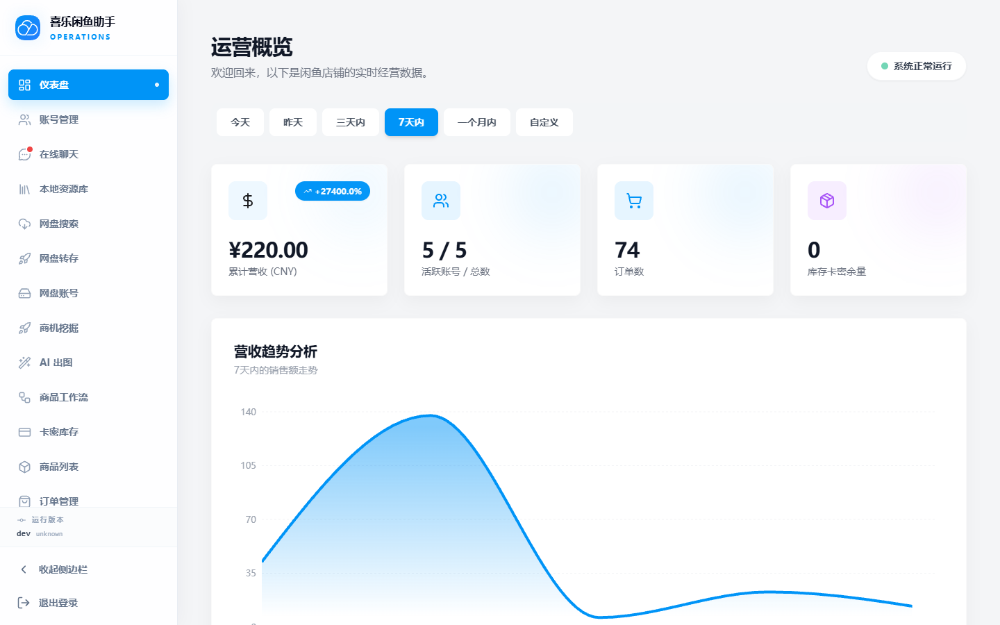
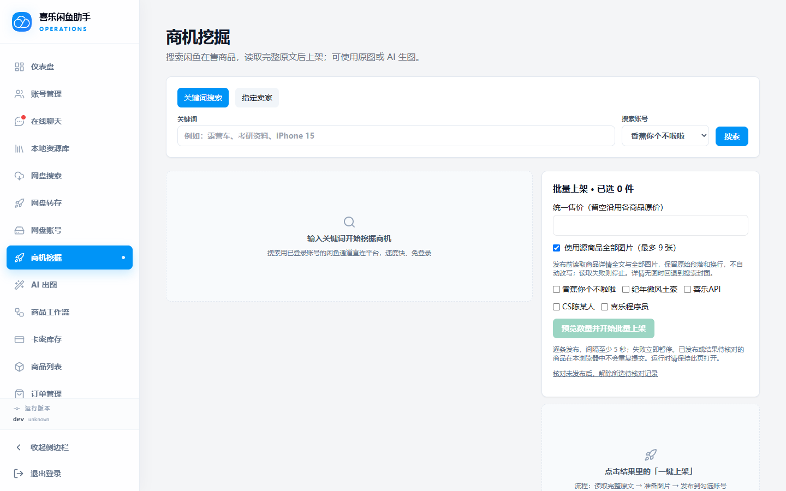
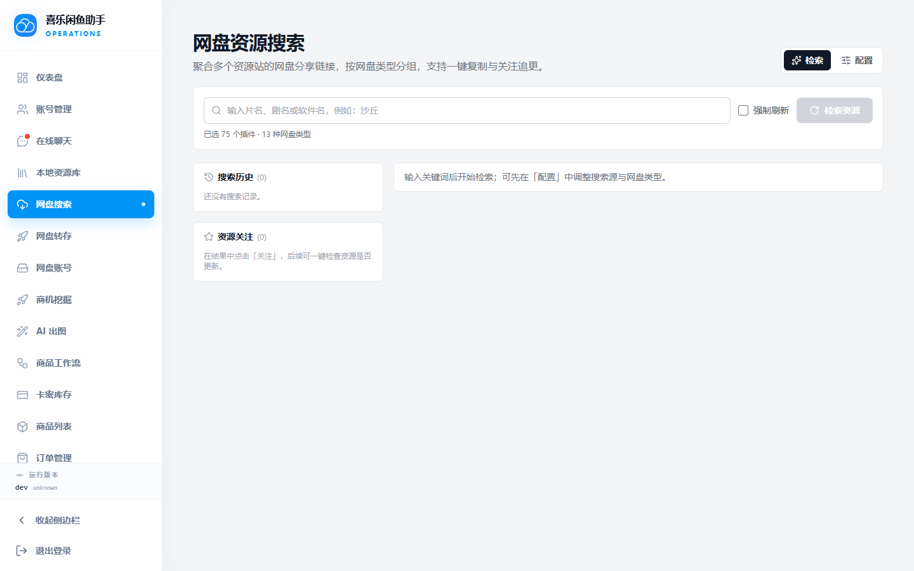
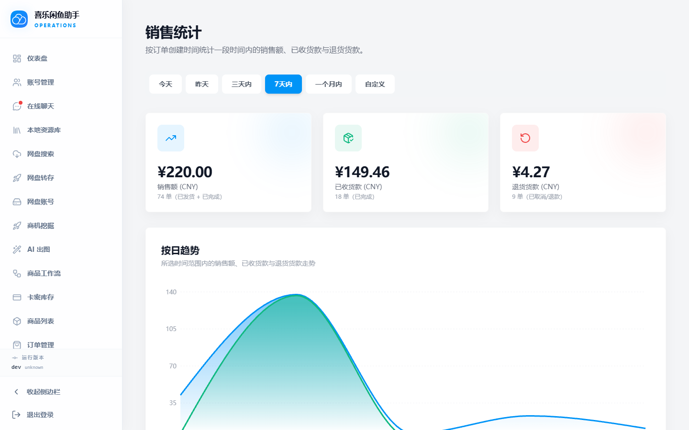

# Xile Xianyu Helper

> A local-first Xianyu operations workbench that connects product sourcing, publishing, customer service, order fulfillment and after-sales into one automated pipeline. Ships as a single Go binary with a React UI, with build scripts for offline Windows and macOS installers.

## Join the community


> **State your purpose when applying**: send a request with a note like "Xile Xianyu Helper + your use case", e.g. "Xile Helper - interested in opportunity mining" or "Xile Helper - purchased, need install help". Requests without a purpose will not be approved, to keep ads out.
>
> In the group: installation and usage help, feature suggestions, Xianyu operations tips. **For software issues, ask in the group for a faster reply.**

[](go.mod)
[](frontend/package.json)
[](internal/db/migrations/)
[](LICENSE)
[](https://github.com/clearlove2008/xile-xianyu-helper/releases/tag/v2026.11.26)

[中文 README](README.zh-CN.md) · [Features](#features) · [Screenshots](#screenshots) · [Quick Start](#quick-start) · [UI Tour](#ui-tour) · [Packaging](#packaging) · [Configuration](#configuration) · [Development](#development) · [License & Attribution](#license--attribution)

> [!IMPORTANT]
> This project is for personal technical study only. It is **not affiliated with or authorized by Xianyu / Alibaba or any netdisk provider**. You are responsible for reviewing and complying with the applicable platform terms and local laws. The authors assume no liability for any consequences of using this software.

---

## What it solves

The time sink in running a Xianyu shop isn't closing sales — it's the repetitive work: hunting for products across the web, filling out publishing forms one by one, watching stock and re-listing sold-out items, answering the same questions, and transferring netdisk resources to generate your own share links.

Xile Xianyu Helper folds those steps into a single locally running workbench:

- **Source**: 75 search plugins + Telegram channels + Xuebapan, with whole-word filtering to drop irrelevant hits.
- **Publish**: multi-image opportunity previews, multi-account batch publishing, automatic handling of inventory limits and shipping-location fallbacks.
- **Operate**: sold-out auto re-listing (2-minute scan by default), multi-account scheduled tasks, AI replies, automatic order fulfillment.
- **Resources**: Quark / Baidu netdisk QR or cookie login, one-click transfer and generation of your own share links, with accounts managed separately.

All data stays on your machine (SQLite by default) — nothing is routed through a third party.

---

## Screenshots

<table>
  <tr>
    <td align="center"><b>Dashboard</b><br></td>
    <td align="center"><b>Opportunity mining &amp; batch publishing</b><br></td>
  </tr>
  <tr>
    <td align="center"><b>Aggregated resource search</b><br></td>
    <td align="center"><b>Sales analytics</b><br></td>
  </tr>
</table>

---

## Features

### 1. Opportunity mining & product workflows (highlight of this release)

A complete path from "what others are selling" to "it's live in my shop":

- **Seller product search**: keyword search over live Xianyu listings, capturing titles, prices and image details, with multi-image support (the single-image limitation in opportunity results has been fixed).
- **Opportunity detail**: the detail endpoint returns the full image list and the UI supports multi-image preview, so you can pick products without jumping between pages.
- **Workflow tasks**: compose "search → filter → one-click publish" into reusable workflows; task state is persisted via the `00064_workflow_tasks.sql` migration.
- **One-click publishing**: select items and accounts directly from opportunity results and publish in bulk through the same MTOP channel used by manual publishing.

### 2. Aggregated search

Multi-source search is compiled **into the same binary** — no separate service, no unified login required:

- **75 search plugins**: covering common netdisk search sites, media, software and study resources; plugins self-register into a unified result model.
- **Telegram channel search**: multiple channels configurable, whole-word matching filter (searching "八仙" no longer drags in unrelated results), correct title attribution.
- **Xuebapan plugin**: HTML search against `xuebapan.com` with 5-page concurrent fetching and up to **100 results** per query; detail-page parsing, extraction-code detection and promo-keyword filtering included.
- Results on the Resource Search page are grouped by source; channels and plugins can be toggled individually.

### 3. Netdisk transfer & sharing (Quark + Baidu)

A netdisk account system isolated from the Xianyu accounts:

- **Login**: QR-code scanning (with automatic QR capture and pixel validation to avoid blank images) or cookie login; real account-state checks prevent guest sessions from being treated as logged in.
- **Transfer flow**: paste someone else's share link → resolve the passcode → transfer into your own account → generate your own new share link, fully automated.
- **Session stability**: scanning requests are not aborted when the login dialog is cancelled.
- See `internal/netdisk/` and `internal/server/netdisk_handlers.go`; data lives in the `00065_netdisk_accounts.sql` migration.

### 4. Publishing, inventory & sold-out re-listing

- **Multi-inventory publishing**: publishes at the target quantity when the platform allows it; when the platform rejects multi-inventory (`multi_inventory_not_allowed`), it automatically drops to 1 item and tops up stock afterwards, remembering the restriction per account.
- **Sold-out auto re-listing**: a dedicated scanner checks for sold-out items and re-lists them every **2 minutes** by default; the interval is configurable via `reshelf_interval_minutes`, with a 30-minute failure cooldown to avoid hammering the API.
- **Shipping-location fallback**: when `FAIL_BIZ_ITEM_EDIT_INVALID_MAP_LOCATION` occurs (virtual items without a submitted shipping location), a default location mapped from a nearby Amap POI is filled in instead of failing the publish.
- **AI-generated image publishing**: supports multi-account selection to generate and publish for several accounts at once.

### 5. Batch image replacement

Replace images on already-listed items without touching other fields:

- The `cmd/imgreplace` tool supports `dry_run`, `account_id`, `force_quantity`, `drop_fields` and a per-item `items` plan.
- The submission payload only changes the image info (URL / width / height) at a given index in `imageInfoDOList`, preserving everything else.
- Known platform limitation: some items return `FAIL_BIZ_PC_NOT_SUPPORT_PUBLISH_OR_EDIT` on PC and must be changed in the Xianyu mobile app; the tool will not damage the original live images.

### 6. Accounts, messaging & automation

- **Multi-account management**: grouping, notes, login-state refresh, scheduled task toggles, pause duration and runtime status at a glance.
- **Live chat**: real-time WebSocket messages, quick replies, image sending and associated item lookup inside a conversation.
- **AI replies**: configurable models and reply policies, order-context-aware responses and price adjustment suggestions.
- **Automated tasks**: auto fulfillment, auto confirm-receipt, bargaining, price adjustments, consign-proof checks and more, with audit events (`00058_automation_audit_events.sql`) and failure circuit-breaking.
- **Fallback**: if a payment notification is lost, a status-based catch-up performs one automatic shipment and resumes unfinished pending-shipment runs, with a 10-minute dedupe window per order.

### 7. Resource library, rules & analytics

- **Resource library**: centrally managed image assets, with the ability to reference images from listed items (migrations `00057` / `00059`).
- **Rules & templates**: default replies, delivery templates, item greetings and card-item templates.
- **Sales analytics**: order and revenue analysis by date range, plus a dashboard overview.

### 8. Environment-free installers

- **Windows 10+**: Inno Setup package with bundled Playwright runtime and Chromium — double-click to install; the background service is managed by `service-control.ps1`.
- **macOS Universal**: cross-compiled amd64 + arm64 binaries, pkg installs to `/Applications/喜乐闲鱼助手`, bundled with Node and Chromium runtime.
- **Linux / Docker**: install/uninstall scripts, a systemd unit and multiple compose files (SQLite / PostgreSQL).

---

## UI Tour

| Menu | What it does |
| --- | --- |
| Dashboard | Account status, order and sales overview, automation alerts |
| Accounts | Multi-account login state, groups, notes, scheduled task settings |
| Opportunity mining | Product search, multi-image detail, filtered one-click publishing |
| Product workflows | Compose and monitor search-to-publish task chains |
| Resource search | 75 plugins + TG channels + Xuebapan aggregated search |
| Netdisk transfer | Quark/Baidu accounts, QR login, transfer and share-link generation |
| Live chat | Real-time conversations, quick replies, AI replies |
| Orders | Order sync, manual fulfillment, missing-order recovery |
| Resource library | Image and asset management |
| Automation rules | Default replies, delivery templates, AI policies |
| Sales analytics | Order and revenue analysis |
| Settings | Port, database, notifications, logs |

The service listens on **`:59188`** by default — open `http://127.0.0.1:59188` in your browser.

---

## Quick Start

### Option 1: Installer (distributed separately)

> Installers are not attached to GitHub Releases. They are shared via separate netdisk links; this repository only provides source code and build scripts.

1. Get the installer for your OS from the distribution channel.
2. Windows: run the installer and follow the wizard; the local database is initialized on first launch.
3. macOS: open the pkg. Since it is unsigned, first launch requires right-click → Open, or approving it in System Settings → Privacy & Security.
4. Visit `http://127.0.0.1:59188`, set an admin password and you're in.

### Option 2: Run from source

Requirements: Go 1.26+, Node 20+.

```bash
git clone https://github.com/clearlove2008/xile-xianyu-helper.git
cd xile-xianyu-helper

# frontend
cd frontend && npm ci && npm run build && cd ..

# backend (SQLite by default, data under ./data)
go run ./cmd/server

# open http://127.0.0.1:59188
```

For PostgreSQL / MySQL, see `compose.yml` and `docs/wiki/Configuration-Reference.md`.

---

## Packaging

Build scripts for offline installers are included:

| Platform | Script | Output |
| --- | --- | --- |
| Windows | `packaging/windows/installer-dist.iss` + `build-resources.ps1` | Offline exe installer with bundled runtime |
| macOS | `packaging/macos/build-xile-cross.py` | Universal pkg (amd64 + arm64) |
| Linux | `packaging/linux/install.sh` | systemd service installer |

Cross-compilation and runtime preparation details are documented in the `packaging/macos/` scripts.

---

## Configuration

Copy `.env.example` to `.env` and fill in your values. **Never commit a populated `.env`** (excluded in `.gitignore`).

Common settings:

| Variable | Description |
| --- | --- |
| `XIANYU_HTTP_PORT` | Service port, default 59188 |
| `XIANYU_BIND_ADDRESS` | Bind address |
| `DATABASE_URL` | Database connection string; local SQLite by default |
| `XIANYU_DATA_KEY` | Local data encryption key |
| `XIANYU_ADMIN_PASSWORD` | Admin password created on first launch |
| `BROWSER_HEADLESS` | Whether to run the browser headless |
| `LOG_LEVEL` / `LOG_FORMAT` | Log level and format |
| `CHANNELS` | Search Telegram channels (comma-separated) |

Runtime parameters such as `reshelf_interval_minutes` can be changed in the UI settings without a restart.

---

## Development

```bash
# Go tests
go test ./...

# frontend tests
cd frontend && npm test

# lint
golangci-lint run
```

Repository layout:

- `cmd/server`, `cmd/tray` — server and tray entry points
- `internal/xianyu/mtop` — Xianyu MTOP APIs (publish, search, orders, image replacement, ...)
- `internal/search` — aggregated search and 75 plugins
- `internal/netdisk` — Quark / Baidu netdisk clients
- `internal/automation`, `internal/workflow` — automation and workflow engines
- `internal/db/migrations` — migrations for three databases
- `frontend/app/features` — React feature modules
- `packaging` — installer scripts for each platform

---

## License & Attribution

This project is released under the Apache License 2.0. It is a distribution forked from another Apache-2.0 licensed open-source project; the original copyright and license notices are preserved as required by the license in [LICENSE](LICENSE) and [NOTICE](NOTICE).

This distribution adds or improves: opportunity mining and product workflows, one-click publishing, embedded aggregated search (75 plugins plus Xuebapan), Telegram whole-word filtering, Quark/Baidu netdisk transfer, sold-out auto re-listing, inventory-limit fallback, shipping-location fallback, multi-account selection for publishing, batch product image replacement, and Windows / macOS offline installer build scripts.

### Security & privacy

- All runtime secrets, cookies, databases, logs and build artifacts have been stripped from this source release.
- Only the `.env.example` template is provided — never commit populated configs, account cookies or database files to any repository.
- Account credentials stay in your local data directory; this project does not upload them.
